# XAI 기반 복지정책 추천 챗봇

> **2026 캡스톤 디자인 · 팀 "정책 어려워?"**
> 자연어 질문으로 맞춤형 공공 복지 정책을 추천하고, **추천 근거를 시각화**하는 설명가능한 AI(XAI) 챗봇

## 프로젝트 소개

복지정책은 중앙정부와 지방자치단체, 여러 수행기관에 흩어져 있어 사용자가 직접 찾고 신청 조건까지 판단해야 합니다. 또한 일반 생성형 AI는 답변의 근거를 제시하지 못하고 존재하지 않는 정책을 만들어 낼 수 있어 행정·복지 분야에 도입하기 어렵습니다.

이 프로젝트는 다음 두 가지 문제를 함께 해결합니다.

1. **AI의 오류 줄이기**: 벡터 검색 + Reranker 기반 RAG로 실제 정책문서 안에서만 답변합니다.
2. **답변의 이유 보여주기**: Captum 기반 2단계 XAI 분석으로 어떤 정책문서와 질문 핵심어가 답변에 영향을 줬는지 보여줍니다.

| | 기존 검색 | 일반 AI 챗봇 | 이 프로젝트 |
|---|---|---|---|
| 질문 방식 | 키워드 | 자연어 | 자연어 |
| 답변 근거 | 정책 목록, 직접 검증 | 근거 불명확 | 문서 기반, 기여도 확인 |

## 주요 기능

- **자연어 정책 질문**: 정책명을 몰라도 "서울에 사는 취업준비생인데 자격증 응시료 지원 받을 수 있나요?"처럼 질문
- **RAG 기반 답변**: Qdrant 벡터 검색 → Reranker 재정렬 → 상위 5개 정책문서로 답변 생성
- **할루시네이션 억제**: 문서에 없는 자격·금액·기간·절차는 임의로 보완하지 않고, 추가 확인이 필요하다고 안내
- **문서 기여도 분석(XAI 01)**: 어떤 정책문서가 답변에 영향을 줬는지 상대 영향도(%) 제공
- **질문 핵심어 기여도 분석(XAI 02)**: 질문의 어떤 단어가 중요했는지 하이라이팅과 그래프로 제공
- **한 화면 UX**: 질문, 검색, 답변, 설명을 한 화면에서 확인. XAI 분석이 실패해도 먼저 생성된 답변은 유지

## 시스템 아키텍처

```mermaid
flowchart LR
    U[사용자 / Web UI] -->|공개 URL| CF[Cloudflare Tunnel]
    CF --> BFF["Frontend BFF<br/>FastAPI :8000<br/>/chat · 대화 관리"]
    BFF -->|/ask| API["RAG/XAI API<br/>FastAPI :9000"]
    BFF -->|/analyze| API
    API --> EMB["질문 임베딩<br/>bge-m3 (1024차원)"]
    EMB --> QD[("Qdrant<br/>Top 30")]
    QD --> RR["Reranker<br/>ko-reranker (Top 10)"]
    RR --> CTX["중복 제거 · 최종 Top 5"]
    CTX --> VLLM["Answer Engine<br/>vLLM :8001<br/>Qwen3-4B + LoRA"]
    VLLM --> CACHE[(rag_cache)]
    CACHE --> XAI["Captum XAI<br/>Feature Ablation<br/>Transformers · SDPA"]
```



### 처리 흐름

1. **질문 입력** → 질문을 `BAAI/bge-m3`로 임베딩
2. **검색** → Qdrant에서 후보 30개 검색
3. **재정렬** → `Dongjin-kr/ko-reranker`로 상위 10개 재정렬 후 정책명+URL 기준 중복 제거, 최종 5개 선별
4. **답변 생성** → 질문 + 시스템 프롬프트 + 정책문서 5개를 vLLM(Qwen3-4B + LoRA)에 전달
5. **XAI 분석** → 캐시된 입력을 재사용해 문서·질문 단어 기여도 계산
6. **통합 표시** → 답변, 검색 결과, 기여도를 한 화면에 전달

### API

| 엔드포인트 | 역할 | 내용 |
|---|---|---|
| `/ask` | 답변 생성 | Query → Qdrant → Reranker → vLLM → `rag_cache` 저장. `answer`, `retrieval_debug`, `metrics` 반환 |
| `/analyze` | 근거 분석 | `rag_cache` 재사용 → Document / Query Feature Ablation → 양수 정규화. `document attribution`, `query attribution`, `answer`, `metrics` 반환 |

## 사용 기술

| 구분 | 기술 |
|---|---|
| 데이터 | 공공데이터포털 한국사회보장정보원 복지서비스 OpenAPI |
| 임베딩 | BAAI/bge-m3 (1024차원, Dense) |
| 벡터 DB | Qdrant (코사인 유사도) |
| Reranker | Dongjin-kr/ko-reranker |
| 생성 모델 | Qwen3-4B-Instruct-2507 + LoRA (PEFT, 추론용 가중치 병합, BF16) |
| 추론 엔진 | vLLM (답변 생성), Transformers·SDPA (XAI 분석) |
| XAI | Captum (Feature Ablation), Kiwi (한국어 핵심어 추출) |
| 서버 | FastAPI, Cloudflare Tunnel |
| 프론트엔드 | HTML / CSS / JavaScript |

## 데이터

정책 1건을 검색 단위 1개로 구성했습니다. (2026.09 기준)

| 출처 | 정책 수 |
|---|---|
| 정부 | 461건 |
| 지자체 | 4,758건 |
| **합계 (Vector Point)** | **5,219건** |

정책명, 지역, 대상, 조건 등 핵심 필드를 표준화한 뒤 임베딩하여 Qdrant에 저장했습니다.

## 답변 생성 설정

- 시스템 프롬프트 원칙: ① 검색된 문서에서 확인되는 내용만 설명 ② 자격·금액·기간·절차를 임의로 보완하지 않음 ③ 문서에 없는 정보는 추가 확인 안내 ④ 관련 정책이 없으면 정보 부족 안내
- 생성 파라미터: `temperature 0.3` · `top_p 0.9` · `max_new_tokens 700` · `repetition_penalty 1.1`

## XAI 분석 방식

두 단계 모두 **Feature Ablation**(입력 일부를 가리고 답변 확률 변화를 측정)을 사용합니다.

| 단계 | 대상 | 방식 |
|---|---|---|
| Document Feature Ablation | 정책문서 5개 | 문서를 하나씩 PAD token으로 마스킹 → 답변의 log-prob 변화 계산 → 음수는 0 처리 후 백분율 정규화 |
| Query Feature Ablation | 질문 핵심어 | Kiwi로 명사·숫자·외국어 선별 → 단어를 하나씩 마스킹 → 양수 변화량을 백분율로 정규화 |

답변 생성은 vLLM, XAI 분석은 같은 Qwen3·LoRA 가중치를 Transformers·Captum으로 불러와 분리 수행합니다.

## 성능 측정

> 환경: G4 (RTX PRO 6000) · 질문 5건 × 조건별 5회 평균(워밍업 3회 제외) · Greedy decoding · 최대 700 tokens

**답변 생성 (`/ask`)**

| 생성 방식 | 평균 생성시간 | 평균 TPS |
|---|---|---|
| Transformers · SDPA | 3.61 s | 72.39 t/s |
| Transformers · FA2 | 4.40 s | 59.96 t/s |
| **vLLM** | **1.93 s** | **131.59 t/s** |

**XAI 분석 (`/analyze`, 문서 5개 + 질문 기준)**

| 질문 단어 분석 방식 | 평균 분석시간 |
|---|---|
| LIG (25-step) | 7.58 s |
| **Feature Ablation** | **1.79 s** |

답변 생성과 XAI 분석을 동시에 구동하기 위해 GPU 메모리를 고려하여 4B 모델을 선택했습니다. (Qwen3-4B 실측 Peak VRAM 약 42 GB)

## 구현 결과

- 서비스 접속 시 질문 팁과 예시 질문을 제공
- 응답 생성 중 로딩 화면을 표시하여 처리 상태 확인 가능
- 검색 순위 변화(Rerank), 답변에 영향을 준 정책(Document), 질문에서 중요했던 조건(Query)을 한 화면에서 확인

## 폴더 구조

```
├── apps/             # 웹 앱 (FastAPI 서버, 채팅 화면)
│   ├── services/     #   대화 저장 등 서비스 로직
│   └── static/       #   프론트엔드 (css, js)
├── notebooks/        # 모델링 파일
├── requirements.txt
└── README.md
```


## 실행 방법

### 1. 환경 준비

```bash
git clone https://github.com/jkh02/<저장소이름>.git
cd <저장소이름>
pip install -r requirements.txt
```

### 2. 사전 준비물

- 정책 데이터가 저장된 **Qdrant** 인스턴스 (`bge-m3` 임베딩, 5,219건)
- **Qwen3-4B-Instruct-2507 + LoRA** 병합 가중치
- 필요한 **API 키 / 환경변수** (예: `.env` 파일, 실제 값은 저장소에 포함하지 않음)

### 3. 서버 실행

```bash
# vLLM (:8001)
# RAG/XAI API (:9000)
# Frontend BFF (:8000)
```

## 한계와 향후 개선

| 현재 한계 | 개선 방향 |
|---|---|
| 정책은 수시로 변경됨 | 정책 데이터 갱신·검증 체계 |
| 검색 결과가 답변의 범위를 결정함 | 검색·답변 품질 벤치마크 |
| XAI 결과의 추가 정확성 검증 필요 | 사용자 검증, 설명 방식 비교 |

## 기대 효과

- **일반 사용자**: 정책명을 몰라도 질문하고, 근거와 중요 조건을 확인하며, 개인화된 안내를 받을 수 있음
- **복지기관·지자체**: 복잡한 조건을 쉽게 이해시키고, 반복 문의의 1차 안내와 복지 사각지대 해소에 기여
- **서비스 운영**: XAI 분석 결과를 모델 성능 분석, 품질 개선, 유지보수에 활용 가능

## 팀

**팀명: 정책 어려워?** · 지도교수: 김종욱

| 이름 | GitHub |
|---|---|
| 진광현 | [@jkh02](https://github.com/jkh02) |
| 이주헌 | 
| 박이언 | 
| 김유빈 | 

팀 프로젝트 원본 저장소: [xai-capstone-2026/XAI_Capstone_Project](https://github.com/xai-capstone-2026/XAI_Capstone_Project)

## 참고문헌

- Lewis, P., et al. (2020). Retrieval-augmented generation for knowledge-intensive NLP tasks. *NeurIPS*.
- Chen, J., et al. (2024). M3-Embedding: Multi-linguality, multi-functionality, multi-granularity text embeddings through self-knowledge distillation. *Findings of ACL*.
- Liu, N. F., et al. (2024). Lost in the middle: How language models use long contexts. *TACL*.
- Kwon, W., et al. (2023). Efficient memory management for large language model serving with PagedAttention. *SOSP*.
- Kokhlikyan, N., et al. (2020). Captum: A unified and generic model interpretability library for PyTorch. *arXiv*.
- Miglani, V., et al. (2023). Using Captum to explain generative language models. *NLP-OSS Workshop*.
- Sundararajan, M., et al. (2017). Axiomatic attribution for deep networks. *ICML*.
- Lee, M. (2024). Kiwi: Developing a Korean morphological analyzer based on statistical language models and skip-bigram. *Korean Journal of Digital Humanities*.
- Yang, A., et al. (2025). Qwen3 technical report. *arXiv*.
- Hu, E. J., et al. (2022). LoRA: Low-rank adaptation of large language models. *ICLR*.
